# Class Activity 1 — System Calls in Practice

- **Student Name:** HAN MENGAN
- **Student ID:** e20230258
- **Date:** 2026-10-20

---

## Warm-Up: Hello System Call

Screenshot of running `hello_syscall.c` on Linux:

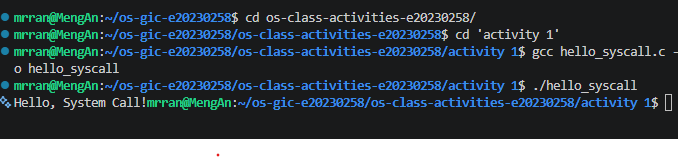

Screenshot of running `hello_winapi.c` on Windows (CMD/PowerShell/VS Code):

Screenshot of running `copyfilesyscall.c` on Linux:

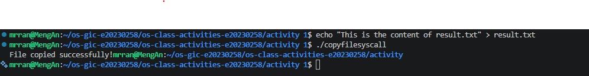

---

## Task 1: File Creator & Reader

### Part A — File Creator

**Describe your implementation:** [What differences did you notice between the library version and the system call version?]

**Version A — Library Functions (`file_creator_lib.c`):**

<!-- Screenshot: gcc -o file_creator_lib file_creator_lib.c && ./file_creator_lib && cat output.txt -->
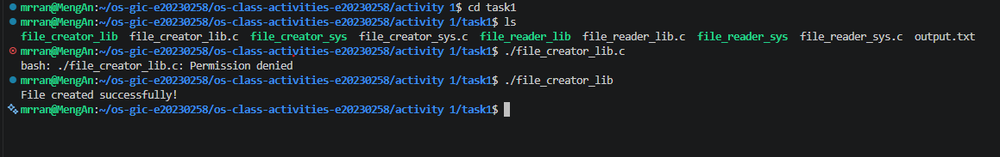

**Version B — POSIX System Calls (`file_creator_sys.c`):**

<!-- Screenshot: gcc -o file_creator_sys file_creator_sys.c && ./file_creator_sys && cat output.txt -->
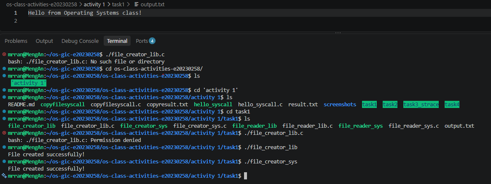

**Questions:**

1. **What flags did you pass to `open()`? What does each flag mean?**

   > - `O_WRONLY` opens for writing
   > - `O_CREAT` creates the file if it does not exist
   > - `O_TRUNC` clears existing contents.

2. **What is `0644`? What does each digit represent?**

   > It is an octal permission mode: owner `6` is read and write, group `4` is read only, and others `4` are read only.

3. **What does `fopen("output.txt", "w")` do internally that you had to do manually?**

   > It opens the file for writing and creates or truncates it. `open()` requires those flags explicitly. `fopen()` also wraps the file descriptor in a buffered `FILE` stream.

### Part B — File Reader & Display

**Describe your implementation:** [Your notes]

**Version A — Library Functions (`file_reader_lib.c`):**

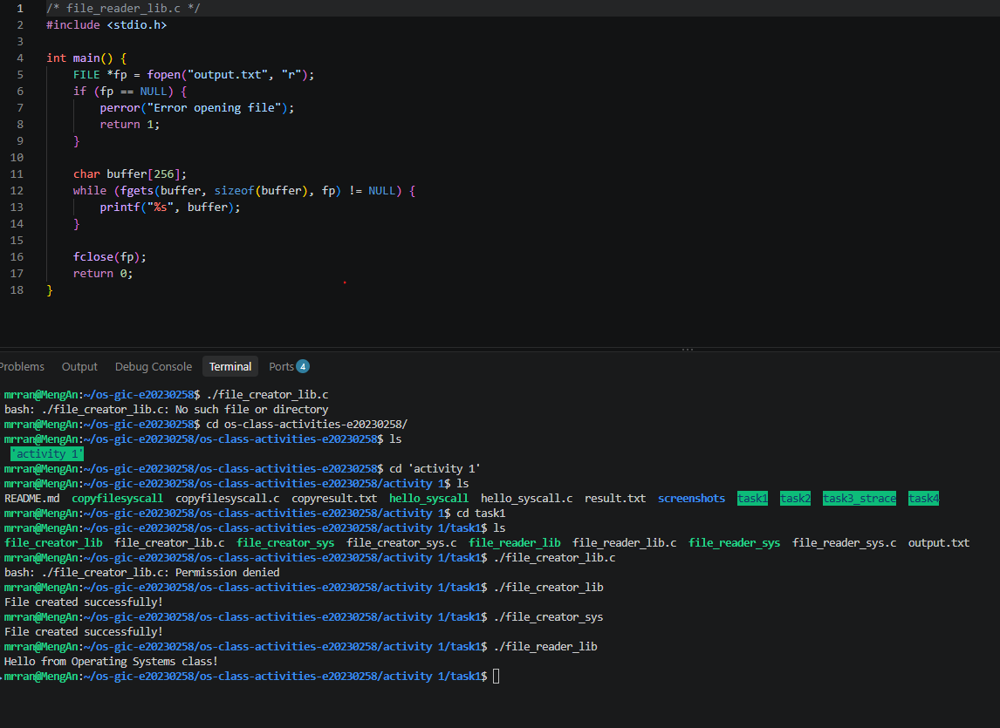

**Version B — POSIX System Calls (`file_reader_sys.c`):**

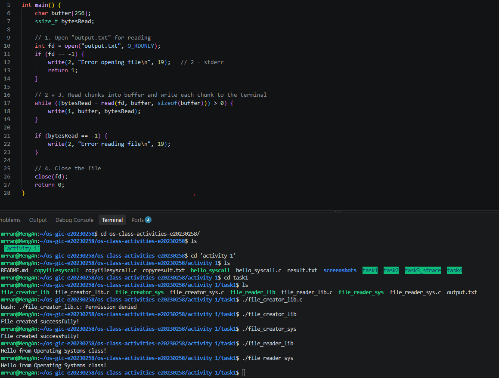

**Questions:**

1. **What does `read()` return? How is this different from `fgets()`?**

   > `read()` returns a byte count, `0` at end of file, or `-1` on error. `fgets()` returns a string pointer or `NULL` and stops at a newline, the buffer limit, or end of file.

2. **Why do you need a loop when using `read()`? When does it stop?**

   > A `read()` call may return fewer bytes than requested. The loop continues until `read()` returns `0` at end of file.

---

## Task 2: Directory Listing & File Info

**Describe your implementation:** [Your notes]

### Version A — Library Functions (`dir_list_lib.c`)

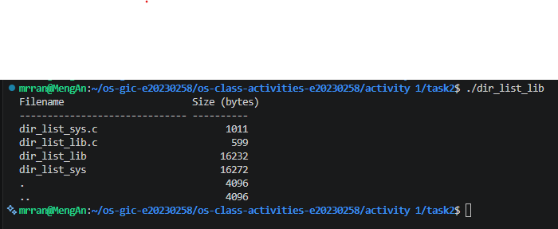

### Version B — System Calls (`dir_list_sys.c`)

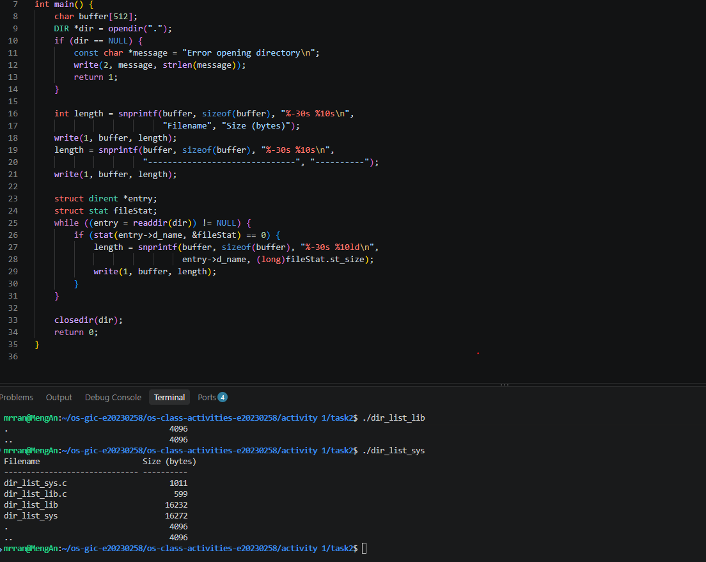

### Questions

1. **What struct does `readdir()` return? What fields does it contain?**

   > It returns a pointer to `struct dirent`, which includes the entry name (`d_name`) and inode number (`d_ino`). Other fields, such as `d_type`, depend on the implementation.

2. **What information does `stat()` provide beyond file size?**

   > It provides file type, permissions, owner and group IDs, inode and link information, device information, and access, modification, and status change times.

3. **Why can't you `write()` a number directly — why do you need `snprintf()` first?**

   > `write()` needs a pointer to bytes, not an integer. `snprintf()` converts the number to text in a character buffer.

---

## Task 3: strace Analysis

**Describe what you observed:** Measured totals from the saved `strace -c` summaries:

- **Task 1 creator:** Library version, 39 total calls and 2 `write()` calls. Version B, 34 total calls and 2 `write()` calls.
- **Task 1 reader:** Library version, 40 total calls and 1 `write()` call. Version B, 35 total calls and 1 `write()` call.
- **Task 2 directory listing:** Library version, 46 total calls and 1 `write()` call. Version B, 52 total calls and 8 `write()` calls.

Full traces and summaries are saved in `task3_strace/`.

### strace Output — Library Version (File Creator)

<!-- Screenshot: strace -e trace=openat,read,write,close ./file_creator_lib -->
<!-- IMPORTANT: Highlight/annotate the key system calls in your screenshot -->
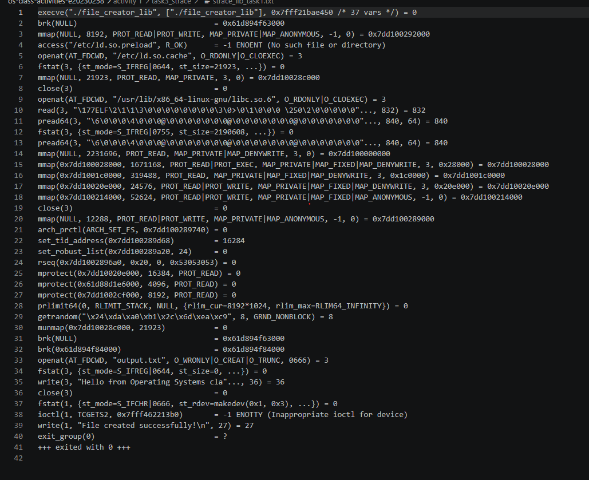

### strace Output — System Call Version (File Creator)

<!-- Screenshot: strace -e trace=openat,read,write,close ./file_creator_sys -->
<!-- IMPORTANT: Highlight/annotate the key system calls in your screenshot -->
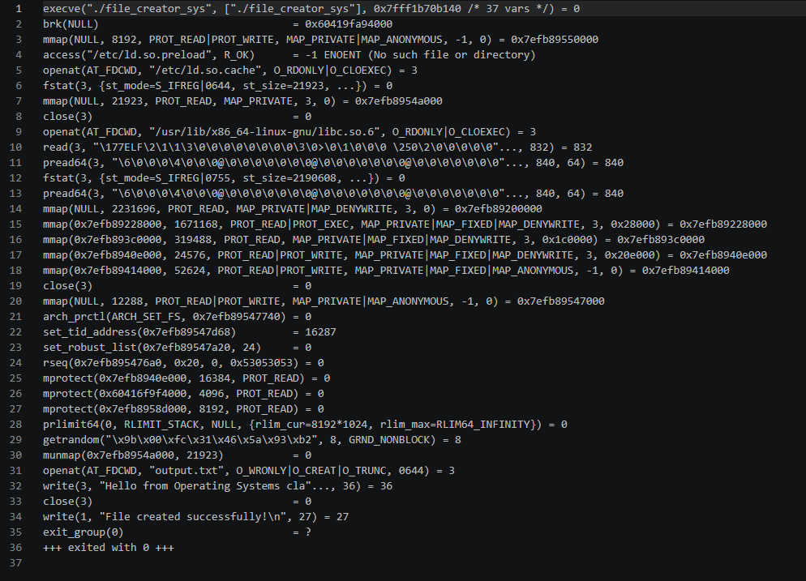

### strace Output — Library Version (File Reader or Dir Listing)

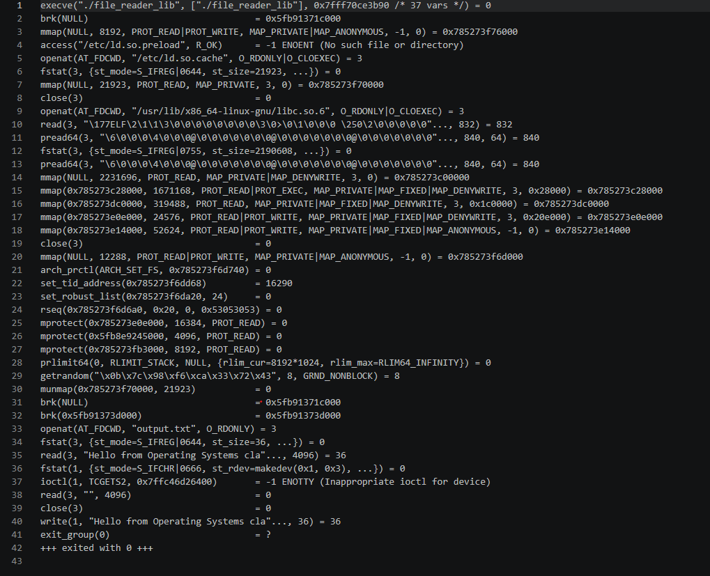

### strace Output — System Call Version (File Reader or Dir Listing)

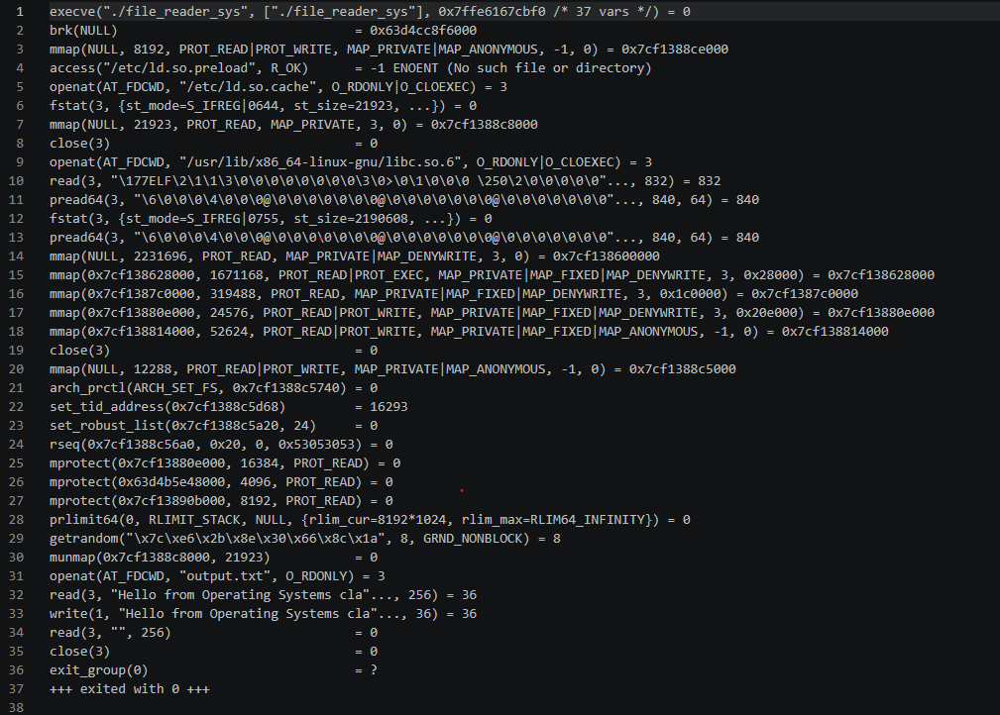

### strace -c Summary Comparison

<!-- Screenshot of `strace -c` output for both versions -->
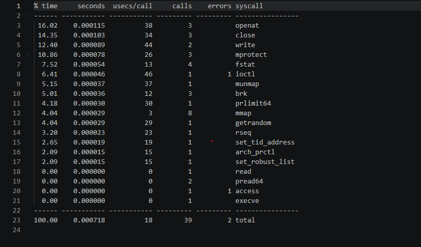
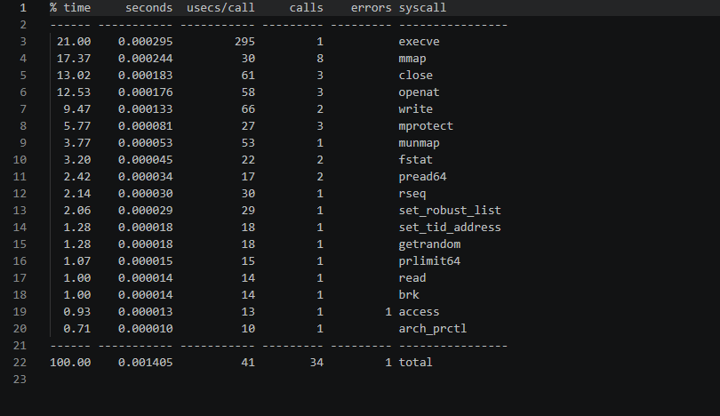

### Questions

1. **How many system calls does the library version make compared to the system call version?**

   > The creator library version made 39 calls and Version B made 34, a difference of 5 calls. The reader library version made 40 calls and Version B made 35.

2. **What extra system calls appear in the library version? What do they do?**

   > The creator trace has one `ioctl` call not present in Version B. The library version also made two more `fstat` calls (4 versus 2) and two more `brk` calls (3 versus 1). `fstat` retrieves file metadata, `brk` adjusts the process heap, and this `ioctl` attempted to query terminal settings.

3. **How many `write()` calls does `fprintf()` actually produce?**

   > `fprintf()` produced one `write()` to the file when the stream was flushed. The creator had two writes total because `printf()` also wrote the confirmation. Buffering combined the formatted file output into one write.

4. **In your own words, what is the real difference between a library function and a system call?**

   > A library function runs in user space and can format or buffer data before making system calls.
   >
   > A system call is the request that crosses into the kernel for an operating system service.

---

## Task 4: Exploring OS Structure

### System Information

> 📸 Screenshot of `uname -a`, `/proc/cpuinfo`, `/proc/meminfo`, `/proc/version`, `/proc/uptime`:

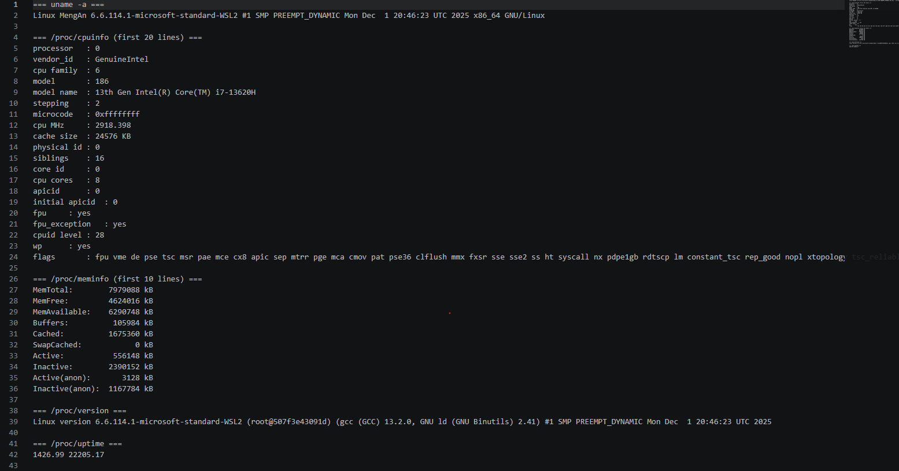

### Process Information

> 📸 Screenshot of `/proc/self/status`, `/proc/self/maps`, `ps aux`:

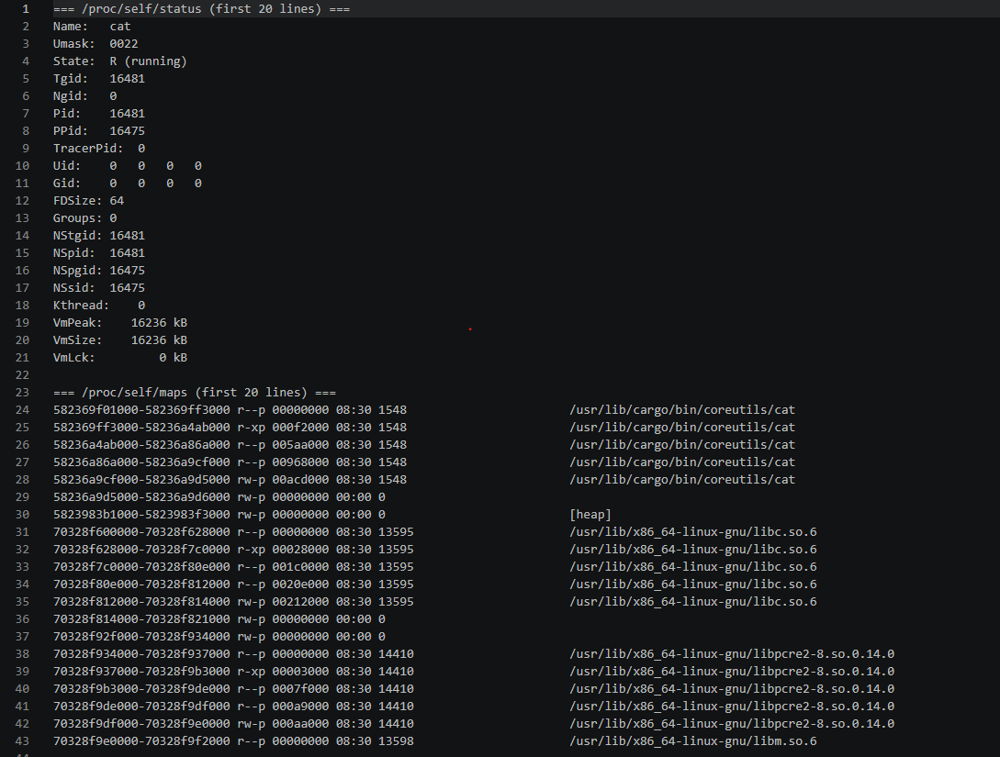

### Kernel Modules

> 📸 Screenshot of `lsmod` and `modinfo`:

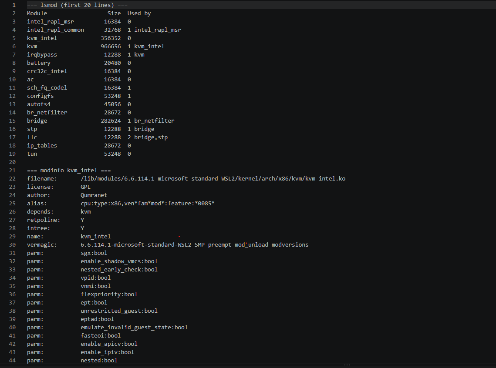

### OS Layers Diagram

> 📸 Your diagram of the OS layers, labeled with real data from your system:

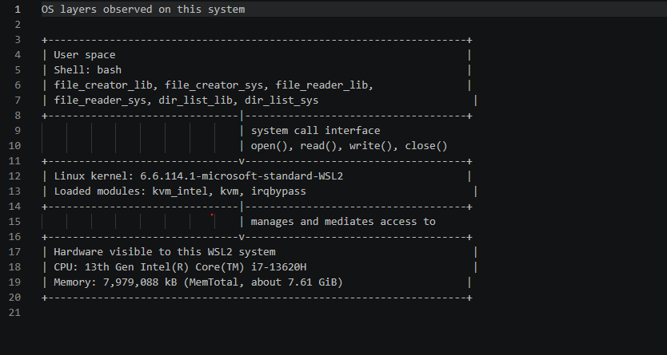

Current outputs are saved in `task4/system_info.txt`, `task4/process_info.txt`, and `task4/kernel_modules.txt`. The system layers diagram is `task4/task4_os_layers_diagram.txt`.

### Questions

1. **What is `/proc`? Is it a real filesystem on disk?**

   > `/proc` is a virtual filesystem, not files stored on disk. The kernel generates its contents from current system and process state.

2. **Monolithic kernel vs. microkernel — which type does Linux use?**

   > - A monolithic kernel runs most operating system services in kernel space.
   > - A microkernel keeps a smaller core in kernel space and moves more services to user space.
   > - Linux uses a modular monolithic kernel. `lsmod` shows loaded modules such as `kvm_intel`, `kvm`, and `irqbypass`.

3. **What memory regions do you see in `/proc/self/maps`?**

   > The first 20 saved lines show executable mappings, the heap, and shared library mappings.

4. **Break down the kernel version string from `uname -a`.**

   > `Linux` is the kernel name; `MengAn` is the host; `6.6.114.1-microsoft-standard-WSL2` is the release; `#1` is the build number; `SMP` indicates multiprocessor support; `PREEMPT_DYNAMIC` is the preemption configuration; `Mon Dec 1 20:46:23 UTC 2025` is the build time; `x86_64` is the architecture; and `GNU/Linux` identifies the operating system environment.

5. **How does `/proc` show that the OS is an intermediary between programs and hardware?**

   > Programs read kernel-generated `/proc` entries rather than accessing hardware directly. The kernel mediates access and exposes selected system and hardware information through a consistent interface.

---

## Reflection

What did you learn from this activity? What was the most surprising difference between library functions and system calls?

> [Write your reflection here]
