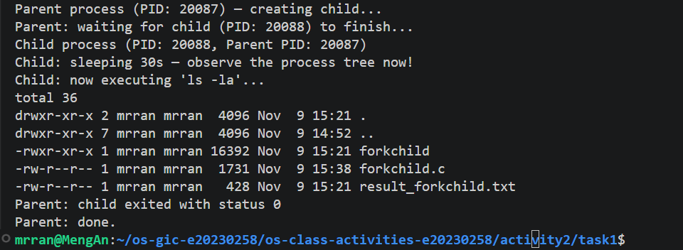
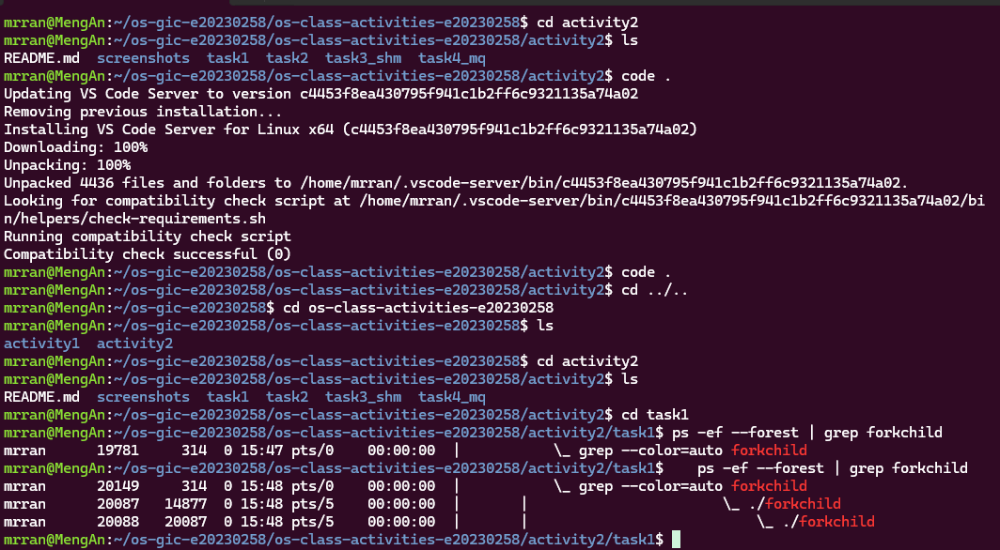
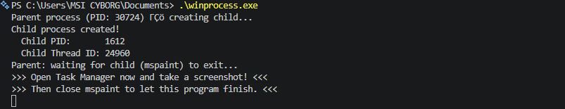
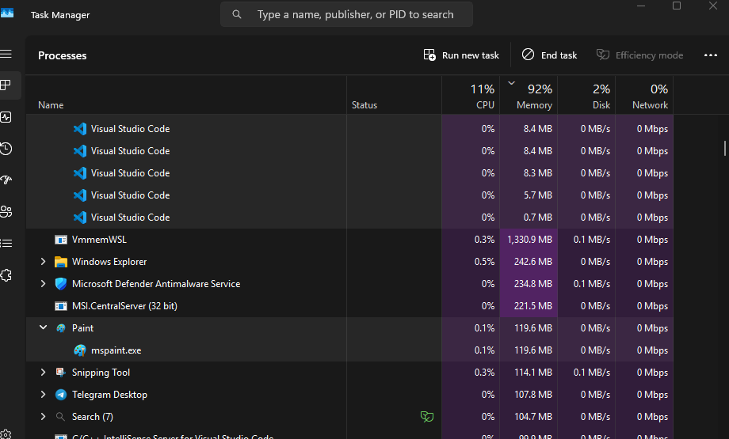
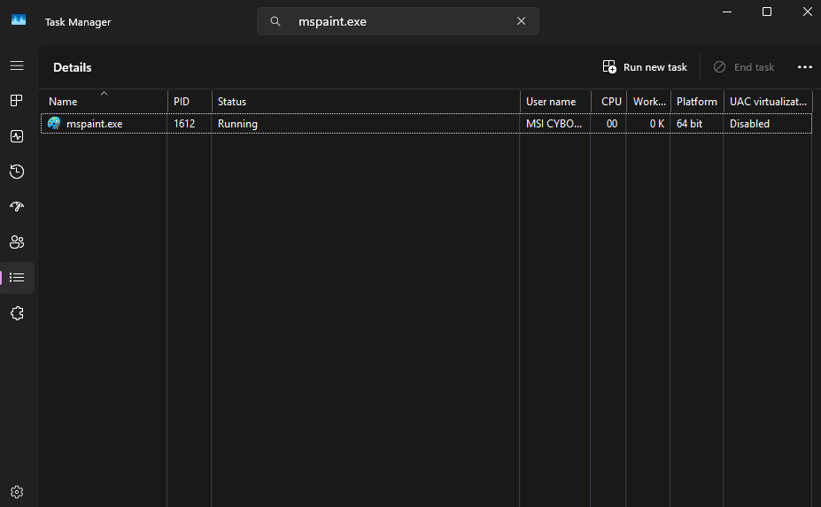
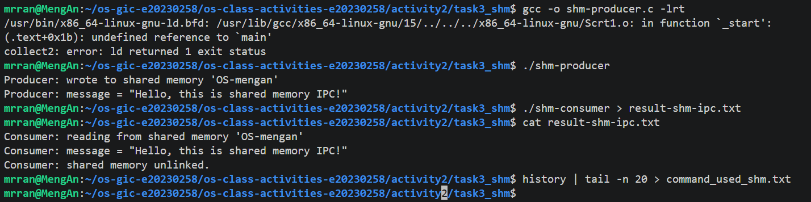
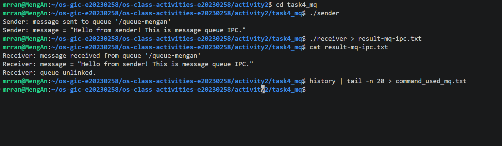

# Class Activity 2 — Processes & Inter-Process Communication

- **Student Name:** HAN MENGAN
- **Student ID:** e20230258
- **Date:** 2026-10-26

---

## Task 1: Process Creation on Linux (fork + exec)

### Compilation & Execution

Screenshot of compiling and running `forkchild.c`:



### Process Tree

Screenshot of the parent-child process tree (using `ps --forest`, `pstree`, or `htop` tree view):



### Output

``` 
total 32
drwxr-xr-x 2 mrran mrran  4096 Nov  9 15:21 .
drwxr-xr-x 7 mrran mrran  4096 Nov  9 14:52 ..
-rwxr-xr-x 1 mrran mrran 16392 Nov  9 15:21 forkchild
-rw-r--r-- 1 mrran mrran  1716 Nov  9 15:19 forkchild.c
-rw-r--r-- 1 mrran mrran     0 Nov  9 15:21 result_forkchild.txt
Parent process (PID: 20087) — creating child...
Parent: waiting for child (PID: 20088) to finish...
Parent: child exited with status 0
Parent: done.
```

### Questions

1. **What does `fork()` return to the parent? What does it return to the child?**

   > `fork()` returns the **child's PID** (a positive number) to the parent, and returns **0** to the child. If it fails, it returns **-1** to the parent and no child is created.

2. **What happens if you remove the `waitpid()` call? Why might the output look different?**

   > The parent would not wait. It would print "Parent: done." and exit right away, while the child is still sleeping. The shell prompt would come back early, and the `ls -la` output would appear later, mixed with the prompt. 

3. **What does `execlp()` do? Why don't we see "execlp failed" when it succeeds?**

   > `execlp()` **replaces** the current process's program with a new program . It searches the `PATH` to find `ls`. The PID stays the same, but the code, data and stack are replaced. If it succeeds, it **never returns**: the old code (including the `perror("execlp")` line) is gone. We only reach the line after `execlp()` if it failed.

4. **Draw the process tree for your program (parent → child). Include PIDs from your output.**

   > ```
   > bash (PID: [shell PID])
   >  └── forkchild — parent (PID: [20087])
   >       └── forkchild — child (PID: [20088], PPID: [parent PID])
   >             └── after execlp → becomes "ls -la" (same PID: [20088])
   > ```

5. **Which command did you use to view the process tree (`ps --forest`, `pstree`, or `htop`)? What information does each column show?**

   > I used `ps -ef --forest | grep forkchild`. The columns are:
   > - **UID**: the user who owns the process
   > - **PID**: the process ID
   > - **PPID**: the parent's process ID (the child's PPID equals the parent's PID)
   > - **C**: CPU usage
   > - **STIME**: the time the process started
   > - **TTY**: the terminal it runs in
   > - **TIME**: total CPU time used
   > - **CMD**: the command. `\_` shows that the process is a child of the line above it.

---

## Task 2: Process Creation on Windows

### Compilation & Execution

Screenshot of compiling and running `winprocess.c`:



### Task Manager Screenshots

Screenshot showing process tree in the **Processes** tab (mspaint nested under your program):



Screenshot showing PID and Parent PID in the **Details** tab:



### Questions

1. **What is the key difference between how Linux creates a process (`fork` + `exec`) and how Windows does it (`CreateProcess`)?**

   > Linux uses **two steps**: `fork()` copies the parent, then `exec()` loads a new program into the copy. Windows uses **one step**: `CreateProcess()` creates a new, empty process and loads the program directly. Windows has no copy of the parent. Also, Windows gives back **handles** (`HANDLE`) plus the PID, while Linux only gives back a PID.

2. **What does `WaitForSingleObject()` do? What is its Linux equivalent?**

   > It blocks the parent until the object (here, the child process handle) is signaled, which for a process means it ended. With `INFINITE`, it waits forever. The Linux equivalent is `wait()` / `waitpid()`.

3. **Why do we need to call `CloseHandle()` at the end? What happens if we don't?**

   > A handle is a reference to a kernel object. `CloseHandle()` tells the OS that we no longer need it, so the kernel can free the process and thread objects. If we don't close the handles, we get a **handle leak**: the kernel keeps the objects in memory even after mspaint exits. In this small program the OS cleans up when our program ends, but in a long-running program the leaks would add up.

4. **In Task Manager, what was the PID of your parent program and the PID of mspaint? Do they match your program's output?**

   > [Fill in after running on Windows], mspaint.exe PID = [1612], mspaint's Parent PID = [30724]. Yes / No, they match the "Parent process (PID: ...)" and "Child PID: ..." lines in my program's output.

5. **Compare the Processes tab (tree view) and the Details tab (PID/PPID columns). Which view makes it easier to understand the parent-child relationship? Why?**

   > The **Processes tab** is easier to read at a glance, because mspaint is shown indented under its parent, like a tree. The **Details tab** is more exact, because it shows the real PID and Parent PID numbers, which I can compare with my program's output. For understanding, I prefer the tree view; for proving the relationship, the Details tab is better.

---

## Task 3: Shared Memory IPC

### Compilation & Execution

Screenshot of compiling and running `shm-producer` and `shm-consumer`:



### Output

```
Consumer: reading from shared memory 'OS-mengan'
Consumer: message = "Hello, this is shared memory IPC!"
Consumer: shared memory unlinked.
```

### Questions

1. **What does `shm_open()` do? How is it different from `open()`?**

   > `shm_open()` creates or opens a **named shared memory object** and returns a file descriptor for it. `open()` opens a normal file on disk. A shared memory object lives in RAM (on Linux it appears in `/dev/shm`), not on disk, and it is meant to be mapped with `mmap()` so that several processes can share it.

2. **What does `mmap()` do? Why is shared memory faster than other IPC methods?**

   > `mmap()` maps the shared memory object into the process's address space, so the process can use it like a normal pointer (`ptr`). It is fast because once it is mapped, processes read and write the memory **directly**. No system call is needed for each message and the data is not copied through the kernel. Pipes and message queues copy the data into the kernel and back out on every send/receive.

3. **Why must the shared memory name match between producer and consumer?**

   > The name is how the OS finds the shared memory object. The producer creates `"OS-mengan"`; the consumer must open the same name to get the same memory. With a different name, the consumer would look for an object that does not exist and get an error.

4. **What does `shm_unlink()` do? What would happen if the consumer didn't call it?**

   > `shm_unlink()` removes the name of the shared memory object. The memory is freed once no process has it mapped any more. If the consumer didn't call it, the object would stay in `/dev/shm/OS-mengan` and use memory until someone removed it or the system rebooted. Running the consumer again would still read the old message.

5. **If the consumer runs before the producer, what happens? Try it and describe the error.**

   > I tried it, and the consumer failed:
   > ```
   > shm_open: No such file or directory
   > Hint: Did you run shm-producer first?
   > ```
   > The consumer opens the object with `O_RDONLY` and without `O_CREAT`, so it cannot create it. Because the producer had not created `"OS-mengan"` yet, `shm_open()` returned -1 with the error `ENOENT` and the program exited with status 1.

---

## Task 4: Message Queue IPC

### Compilation & Execution

Screenshot of compiling and running `sender` and `receiver`:



### Output

```
Receiver: message received from queue '/queue-mengan'
Receiver: message = "Hello from sender! This is message queue IPC."
Receiver: queue unlinked.
```

### Questions

1. **How is a message queue different from shared memory? When would you use one over the other?**

   > With **shared memory**, processes share the same memory and read/write it directly. It is very fast, but the programmer must handle synchronization (for example with a semaphore). Otherwise, the reader may read before the writer finishes.
   > With a **message queue**, the kernel stores separate messages in order and handles the synchronization: `mq_receive()` waits until a message arrives. It is easier and safer, but slower because every message is copied into and out of the kernel.
   > Use shared memory for **large or frequent data** where speed matters. Use a message queue for **small, separate messages** where simplicity and order matter.

2. **Why does the queue name in `common.h` need to start with `/`?**

   > POSIX requires it: a portable queue name has the form `/somename` (one slash at the start and no other slashes). On Linux, `mq_open()` returns `EINVAL` if the name does not start with `/`. Linux keeps the queues in a special filesystem (`/dev/mqueue`), so the name works like a file name in that directory.

3. **What does `mq_unlink()` do? What happens if neither the sender nor receiver calls it?**

   > `mq_unlink()` removes the queue name. The queue is destroyed after every process has closed it. If nobody calls it, the queue stays in the kernel (visible as `/dev/mqueue/queue-mengan`) until reboot, and any messages left in it remain. The next receiver would read those old messages.

4. **What happens if you run the receiver before the sender?**

   > I tried it, and the receiver failed:
   > ```
   > mq_open: No such file or directory
   > Hint: Did you run sender first?
   > ```
   > The receiver opens the queue with `O_RDONLY` only (no `O_CREAT`), so if the sender has not created `/queue-mengan` yet, `mq_open()` fails with `ENOENT` and exits with status 1. (If the queue existed but was empty, the receiver would instead **block** and wait for a message, because the queue is in blocking mode.)

5. **Can multiple senders send to the same queue? Can multiple receivers read from the same queue?**

   > **Yes to both.** Many senders can open the same queue name and send messages. Many receivers can also open it, but each message is delivered to **only one** receiver: once a receiver takes it, it is removed from the queue. Messages with higher priority come out first; messages with the same priority come out in FIFO order.

---

## Reflection

What did you learn from this activity? What was the most interesting difference between Linux and Windows process creation? Which IPC method do you prefer and why?

> In this activity I learned how a program creates a child process and how two separate processes can exchange data. The most interesting difference is that Linux first **copies** the parent with `fork()` and then replaces it with `exec()`, while Windows does everything in one `CreateProcess()` call. The Linux way felt strange at first, but it means the child can set things up before running the new program.
>
> For IPC, I saw that the order matters: when I ran the consumer or receiver first, it failed with "No such file or directory", because the object did not exist yet. I prefer **message queues** for simple tasks, because the kernel keeps the messages in order and makes the receiver wait, so I don't need extra synchronization. For large amounts of data, shared memory is better because it is faster.
