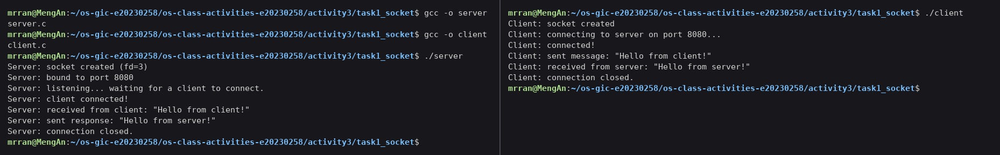
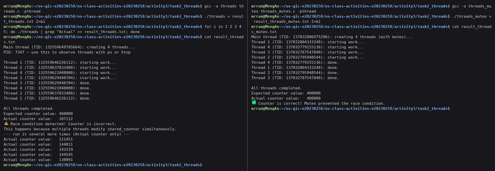
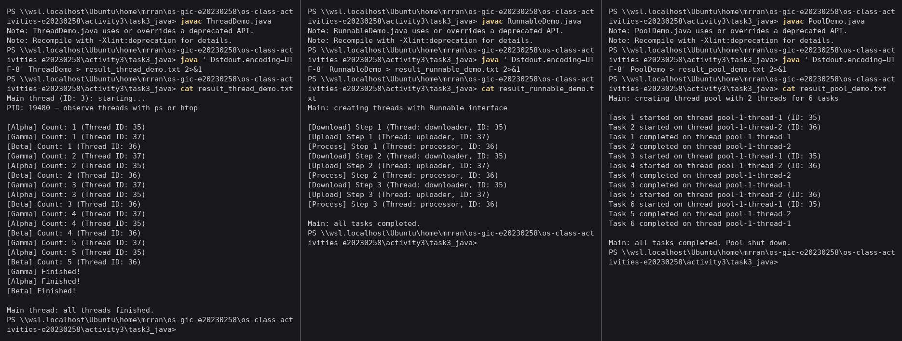
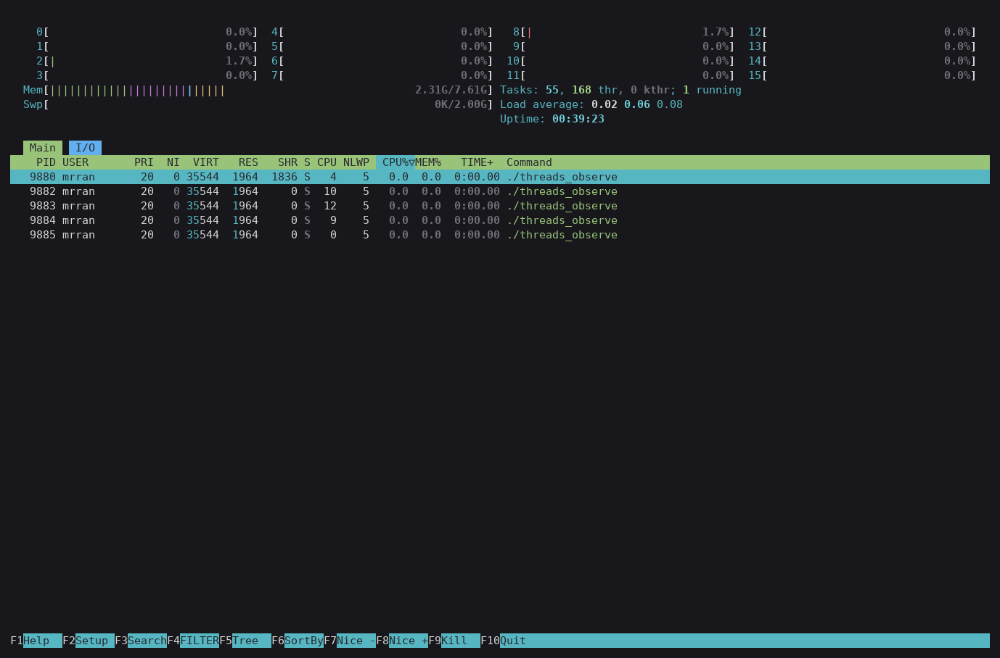
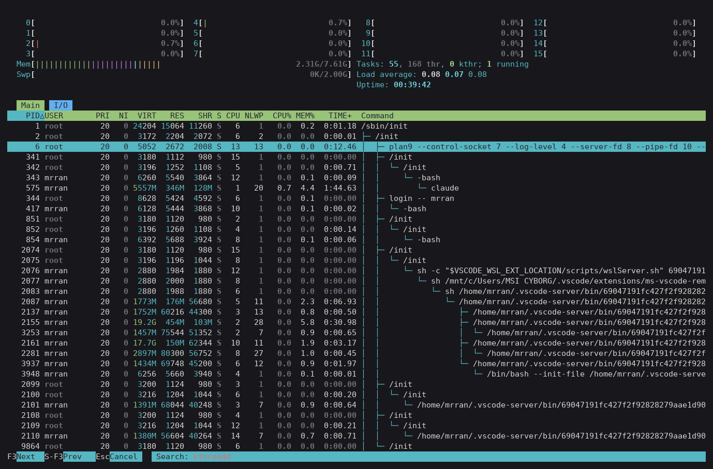
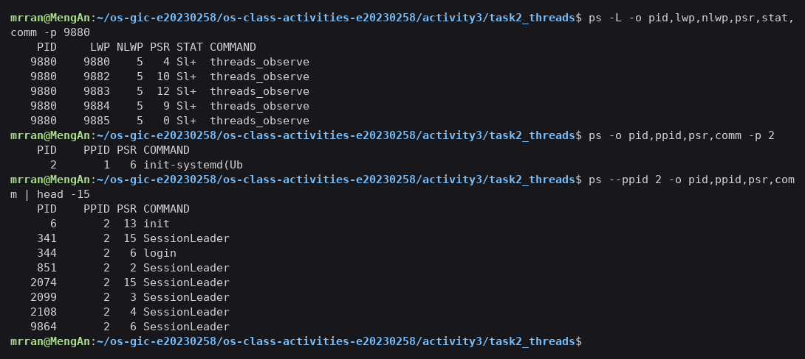
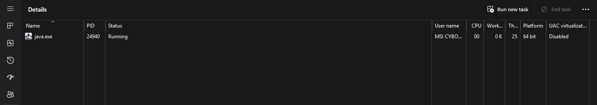

# Class Activity 3 — Socket Communication & Multithreading

- **Student Name:** HAN MENGAN
- **Student ID:** e20230258
- **Date:** 2026-11-16

> Setup: Windows 11 + WSL2 (Ubuntu 26.04, gcc 15.2, htop 3.4.1). Tasks 1, 2 and 4A ran in WSL. Task 3 and 4B ran natively on Windows with JDK 25 in PowerShell.

---

## Task 1: TCP Socket Communication (C)

### Compilation & Execution



Output files: [`result_socket.txt`](task1_socket/result_socket.txt), [`command_used_socket.txt`](task1_socket/command_used_socket.txt)

### Answers

1. **Role of `bind()` / Why client doesn't call it:**
   > `bind()` attaches the server socket to a fixed address and port (any interface, port 8080), so clients know where to find it. The client doesn't care which port it uses, so it skips `bind()` and the OS gives it a random free port when it calls `connect()`.

2. **What `accept()` returns:**
   > It returns a new socket fd that is only for that one client. The original `server_fd` (fd=3 in my run) just keeps listening for new connections. All the `read()`/`send()` with the client goes through the new fd, not the listening one.

3. **Starting client before server:**
   > I tried it with no server running (nothing listening on 8080). The client printed `Client: socket created` and `Client: connecting to server on port 8080...` then failed with `connect: Connection refused` and exit code 1. There's no process on that port so the kernel just rejects the connection.

4. **What `htons()` does:**
   > It converts a 16-bit number from host byte order to network byte order (big-endian). My PC is x86, which is little-endian, so without it 8080 (0x1F90) would be sent with the bytes swapped and the server would actually listen on port 36895 (0x901F). Both sides have to agree on byte order, that's why the network uses one fixed order.

5. **Socket call sequence diagram:**
   ```
        SERVER                          CLIENT
        socket()                        socket()
          |                               |
        bind()  (port 8080)               |
          |                               |
        listen()                          |
          |                               |
        accept()  <---- TCP handshake --- connect()
          |                               |
        read()    <---- "Hello from client!" --- send()
          |                               |
        send()    ---- "Hello from server!" ---> read()
          |                               |
        close()                         close()
   ```

---

## Task 2: POSIX Threads (C)

### Output — Without Mutex (Race Condition)



### Output — With Mutex (Correct)

Same screenshot, right side. Without the mutex the counter was 187112 instead of 400000, and 5 more runs gave 121451, 144011, 143219, 144545, 130091 (all wrong, all different). With the mutex it was exactly 400000.

Output files: [`result_threads.txt`](task2_threads/result_threads.txt), [`result_threads_mutex.txt`](task2_threads/result_threads_mutex.txt), [`command_used_threads.txt`](task2_threads/command_used_threads.txt)

### Answers

1. **What is a race condition?**
   > It's when two or more threads use the same data at the same time and the result depends on who runs first. `shared_counter++` looks like one step but it's really read, add 1, write back. Two threads can read the same old value, both add 1, and both write it back, so one increment is lost. That's why I got around 120k–190k instead of 400000.

2. **What does `pthread_mutex_lock()` do?**
   > It locks the mutex so only one thread at a time can get into the code between lock and unlock. If another thread already holds it, the caller waits. So the read-add-write of the counter can't overlap anymore and no update gets lost. That's why the mutex version gave 400000.

3. **Removing `pthread_join()`:**
   > I tried it on a copy of `threads.c` (with the join loop removed). Main didn't wait at all. It printed "All threads completed" right away with a tiny counter (26418, 17785 and 32374 in 3 runs), then returned, and that killed the whole process. Only 2–3 threads even got to print "starting work", none printed "done". One thread also printed `Thread 0`, probably because main's `thread_ids` array was already gone when the thread read it.

4. **Thread vs Process:**
   > A process has its own memory space. A thread is a smaller unit inside a process. Threads in the same process share code, global data (like `shared_counter`), heap and open files. Each thread has its own stack, registers, program counter and thread ID. Making a thread is cheaper than `fork()`, but because memory is shared you need locks like a mutex.

---

## Task 3: Java Multithreading

Ran on Windows (PowerShell, JDK 25). I added `-Dstdout.encoding=UTF-8` because otherwise the `—` in the PID line got messed up when redirected to a file. `javac` shows a deprecation note because `Thread.getId()` is deprecated in newer JDKs, but it still works.

### ThreadDemo Output



### RunnableDemo Output

Same screenshot (middle). File: [`result_runnable_demo.txt`](task3_java/result_runnable_demo.txt)

### PoolDemo Output

Same screenshot (right). File: [`result_pool_demo.txt`](task3_java/result_pool_demo.txt)

Other files: [`result_thread_demo.txt`](task3_java/result_thread_demo.txt), [`command_used_java.txt`](task3_java/command_used_java.txt)

### Answers

1. **Thread vs Runnable:**
   > Extending `Thread` means your class *is* a thread, and since Java only has single inheritance you can't extend anything else. Implementing `Runnable` just describes the task, and you hand it to a `Thread` (or a thread pool). I'd use `Runnable` most of the time because it's more flexible and works with `ExecutorService`. Extending `Thread` is fine for quick small demos.

2. **Pool size limiting concurrency:**
   > The pool only has 2 worker threads (`newFixedThreadPool(2)`), so only 2 tasks can run at the same time and the other 4 wait in the queue. In my output Tasks 1 and 2 started together, then 3 and 4, then 5 and 6, and only `pool-1-thread-1` (ID 35) and `pool-1-thread-2` (ID 36) were ever used.

3. **thread.join() in Java:**
   > `join()` makes the calling thread (main) wait until that thread is finished. I tried removing the 3 joins on a copy of `ThreadDemo`. "Main thread: all threads finished." printed right after the PID line, before any counting even started, so the message was wrong. Alpha/Beta/Gamma still counted to 5 and finished because the JVM waits for normal (non-daemon) threads before it exits.

4. **ExecutorService advantages:**
   > It reuses a fixed set of threads instead of creating a new one for every task, which saves a lot of overhead. It also caps how many threads run at once so you don't flood the system. And it handles the task queue, shutdown, and getting results back (`Future`) for you, so you don't have to manage all that by hand.

---

## Task 4: Observing Threads

Note: WSL2 hides the kernel's own threads. Here PID 2 is WSL's `init-systemd(Ubuntu)`, not `kthreadd` (more in answer 5).

### Linux — `ps -eLf` Output

From [`result_observe_linux.txt`](task2_threads/result_observe_linux.txt) (I used `grep "[t]hreads_observe"` so the grep line itself doesn't show up):

```
mrran       9880    9866    9880  0    5 21:38 pts/7    00:00:00 ./threads_observe
mrran       9880    9866    9882  0    5 21:38 pts/7    00:00:00 ./threads_observe
mrran       9880    9866    9883  0    5 21:38 pts/7    00:00:00 ./threads_observe
mrran       9880    9866    9884  0    5 21:38 pts/7    00:00:00 ./threads_observe
mrran       9880    9866    9885  0    5 21:38 pts/7    00:00:00 ./threads_observe
    PID    SPID TTY          TIME CMD
   9880    9880 pts/7    00:00:00 threads_observe
   9880    9882 pts/7    00:00:00 threads_observe
   9880    9883 pts/7    00:00:00 threads_observe
   9880    9884 pts/7    00:00:00 threads_observe
   9880    9885 pts/7    00:00:00 threads_observe
--- /proc/9880/task/ listing ---
9880
9882
9883
9884
9885
```

### Linux — htop Thread View

Filtered with `F4` → `threads_observe`, with the PROCESSOR (CPU) and NLWP columns added. Pressing `H` once dropped it to 1 row and pressing it again brought back the 5 threads.



### Linux — htop Kernel Threads (tree view, `kthreadd`)

Pressed `K`, then `F5` for tree view, then `F3` to search for `kthreadd`. The search box turns red because there's no `kthreadd`. The header says `0 kthr`, and the tree starts with `/sbin/init` (PID 1) → `/init` (PID 2, WSL's init).



### Linux — Kernel Threads (commands)



```
$ ps -L -o pid,lwp,nlwp,psr,stat,comm -p 9880
    PID     LWP NLWP PSR STAT COMMAND
   9880    9880    5   4 Sl+  threads_observe
   9880    9882    5  10 Sl+  threads_observe
   9880    9883    5  12 Sl+  threads_observe
   9880    9884    5   9 Sl+  threads_observe
   9880    9885    5   0 Sl+  threads_observe

$ ps -o pid,ppid,psr,comm -p 2
    PID    PPID PSR COMMAND
      2       1   6 init-systemd(Ub

$ ps --ppid 2 -o pid,ppid,psr,comm | head -15
    PID    PPID PSR COMMAND
      6       2  13 init
    341       2  15 SessionLeader
    344       2   6 login
    851       2   2 SessionLeader
   2074       2  15 SessionLeader
   2099       2   3 SessionLeader
   2108       2   4 SessionLeader
   9864       2   6 SessionLeader
```

### Windows — Task Manager

Ran a temp copy of `ThreadDemo` with the sleep changed to 5000 ms (the real file still has 500). Details tab, filtered by "java", Threads column ("Th...") added.



### Answers

1. **LWP column meaning:**
   > LWP = light weight process, which is just the thread ID the kernel gives each thread. Every row in `ps -eLf` is one thread. All 5 rows have the same PID (9880) but different LWPs (9880, 9882, 9883, 9884, 9885), and NLWP = 5 is the number of threads in the process.

2. **/proc/PID/task/ count:**
   > 5 entries: 9880, 9882, 9883, 9884, 9885. That matches the program exactly: 1 main thread + 4 workers.

3. **Extra Java threads:**
   > Task Manager showed 25 threads for `java.exe` (PID 24940), and `Get-Process` said 25 at the same moment, even though I only made 3 (plus main). The JVM runs its own threads too. `jstack` listed 21 of them, like `Reference Handler`, `Finalizer`, `Signal Dispatcher`, `C1/C2 CompilerThread0` (JIT), the GC threads (`G1 ...`, `GC Thread#0`), `VM Thread` and `Common-Cleaner`. The other 4 are native threads that jstack doesn't list. Funny detail: my 3 threads show up as `Thread-0/1/2` in jstack, because the `name` field in `CounterThread` doesn't actually set the thread's name.

4. **Linux vs Windows thread viewing:**
   > Linux gives way more detail: each thread gets its own row with its ID, state and the core it ran on (`ps -L`, `htop`), and `/proc/<PID>/task/` has a folder per thread. Task Manager only shows one number (the thread count) per process. To see individual threads on Windows I had to use `jstack`.

5. **kthreadd and three kernel threads:**
   > On normal Linux, `kthreadd` is PID 2 and it's the parent of all kernel threads (things like `ksoftirqd/0`, `rcu_sched`, `kworker/...`, shown in `[brackets]` because they have no user memory). But WSL2 hides them. On my system PID 2 is `init-systemd(Ub)` (WSL's own init), `ps --ppid 2` only shows `init`, `SessionLeader` and `login` (normal processes, not kernel threads), htop says `0 kthr`, searching for `kthreadd` finds nothing, and `ps -ef` has no bracketed names at all. So I couldn't find three kernel threads here. They exist in the real kernel, WSL just doesn't show them.

6. **TID equal to PID, NLWP and cores:**
   > The main thread has LWP 9880, same as the PID. NLWP is 5. The threads were on cores 4, 10, 12, 9 and 0 (PSR in `ps`, same numbers in htop's CPU column). When I checked again later they were still on the same cores, since they were just sleeping.

7. **`H` and `K` in htop:**
   > `H` shows/hides user threads. With it off I only saw 1 row for `threads_observe`, with it on I saw all 5. `K` shows/hides kernel threads. Without it you'd only see normal processes and miss stuff like `kthreadd` and its children. In WSL pressing `K` changed nothing because there are 0 kernel threads to show.

---

## Reflection

> The race condition was the most interesting part. Seeing the counter come out different every run (121k to 187k instead of 400000) made it obvious that `counter++` isn't one step, and the mutex fixed it right away. Watching the threads in `ps` and htop also showed me that a pthread is a real kernel task with its own ID, and that the JVM quietly runs about 20 extra threads. Knowing this helps me write better concurrent code: lock shared data, always join threads, and use a thread pool instead of making tons of threads. Also, WSL doesn't show everything a real Linux kernel does.
