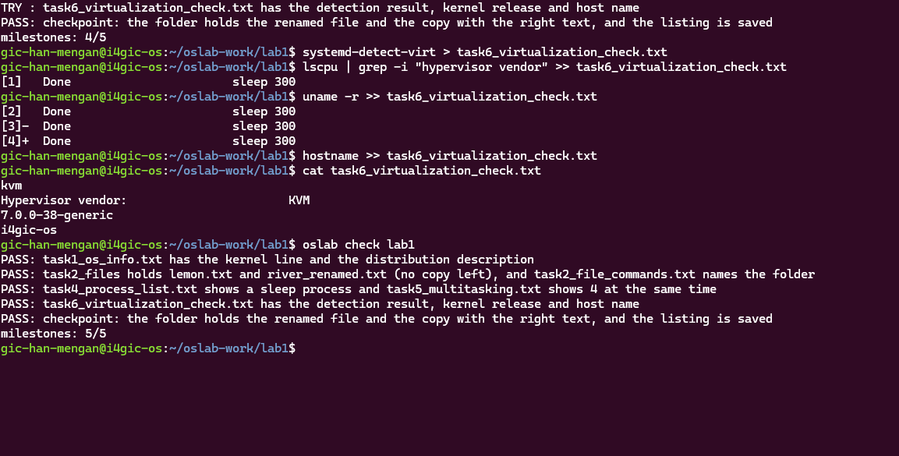

# OS Lab 1 Submission
---

- **Student Name:** HAN MENGAN
- **Student ID:** e20230258
- **Ubuntu username on the server:** gic-han-mengan
- **My values (`oslab values lab1`):** file1 = lemon , file2 = river , count = 4


---

## Task 1: Operating System Identification

- **Kernel version:** The number in the kernel version is: 7.0.0-38-generic. The kernel is the core of Linux that talks to the hardware.
- **Distribution version:** Ubuntu 26.04.1 LTS which release on 26.04. That's the Ubuntu system built on top of the kernel

'''text
Linux i4gic-os 7.0.0-38-generic #38-Ubuntu SMP PREEMPT_DYNAMIC Fri Sep  4 09:10:14 UTC 2026 x86_64 GNU/Linux
Distributor ID: Ubuntu
Description:    Ubuntu 26.04.1 LTS
Release:        26.04
Codename:       resolute
'''

---

## Task 2: Essential Linux File and Directory Commands
- **Creating:** I created 'lemon.txt' and 'river.txt' with touch.
- **Copying:** I copied 'lemon.txt' to 'lemon_copy.txt' with cp.
- **Renaming:** I renamed 'river.txt' to 'river_renamed.txt' with mv.
- **Deleting:** I deleted 'lemon_copy.txt' with rm.
- **Last: 'ls' ** It showed 'lemon.txt' and 'river_renamed.txt'

```text
/home/gic-han-mengan/oslab-work/lab1/task2_files
lemon.txt
river.txt
lemon.txt
lemon_copy.txt
river.txt
task2_file_commands.txt
lemon.txt
lemon_copy.txt
river_renamed.txt
task2_file_commands.txt
lemon.txt
river_renamed.txt
```

---

## Task 3: Package Management Using APT

- **apt remove:** deletes the program itself, such as /usr/bin/mc, but keeps its system configuration files in /etc.
- **apt purge:** deletes the program and its configuration files. /etc/mc was completely gone.

-ld /etc/mc` and your prompt. -->
[Task 3](images/task3.png)

---

## Task 4: Programs vs Processes

I stated 'sleep' in the background with 'sleep 60 &'. The '&' let it run in the background, so my shell was free to run 'ps' and find it in the process list.

A **program** is a file stored on disk. It does nothing on its own. A **process** is a program that is running, with its own PID and memory. The 'sleep' program stayed on disk the whole time, but the process only existed while it was running.

- **Before:** 'ps' showed only 'bash' and 'ps'. There was no sleep process.
- **during:** 'ps' showed a 'sleep' process with PID **103611**
- **After:** once 'sleep' finished, it was gone from the list agian.


---

## Task 5: Multitasking
- **Multitasking:** is the operating system's ability to run many processes at the same time.

I started four 'sleep' commands in the background with '&' and then ran 'ps' showed 4 sleep lines. each lines has its own PID. This shows the system can keep many processes alive at the same time and also this does not show that the processes autually run at the same instant. CPU core runs only one process at a time. the scheduler switches between them very quickly


<!-- SCREENSHOT: terminal with the `ps` result and your prompt. -->
[Task 5](images/task5.png)

---

## Task 6: Virtualization and Hypervisor Detection

My system ('i4gic-os) is running on a **virtual machine**, not physical hardware.

- 'systemd-detect-virt' printed 'kvm', which means the system runs under the KVM hypervisor.
- 'lscpu | grep -i "hypervisor vendor" showed 'Hypervisor vendow: KVM'




---

## My Prediction: Confirmed or Corrected

For each prediction answer (`oslab predict lab1`), write **confirmed** or **corrected** and what you saw that shows it. You test the third answer (`apt-get remove`) in Task 3.

---

## Plus / Challenge (only if you did them)

Your answers.

## AI Note (optional)

One suggestion an AI tool gave you and how you checked it.